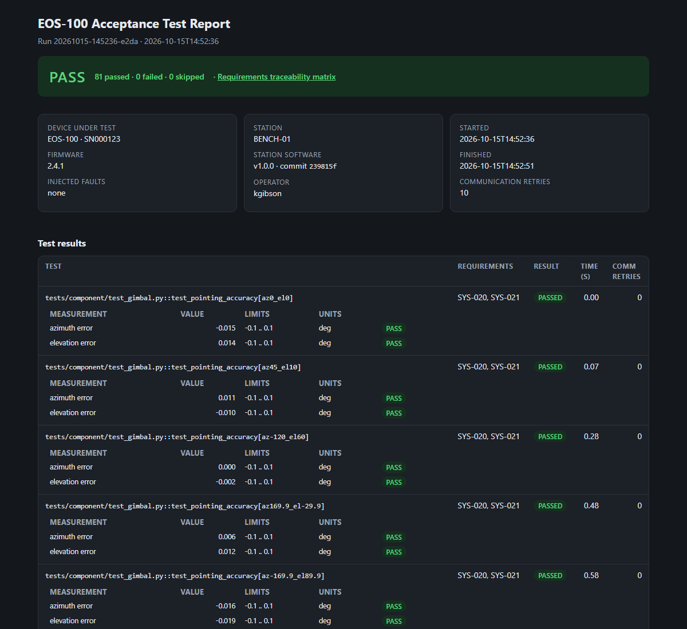
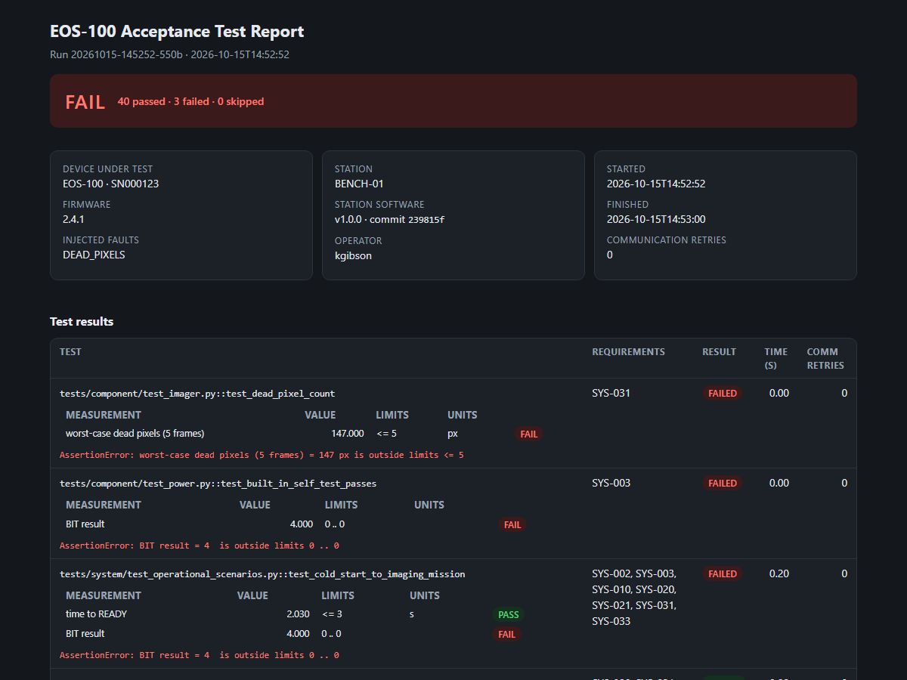
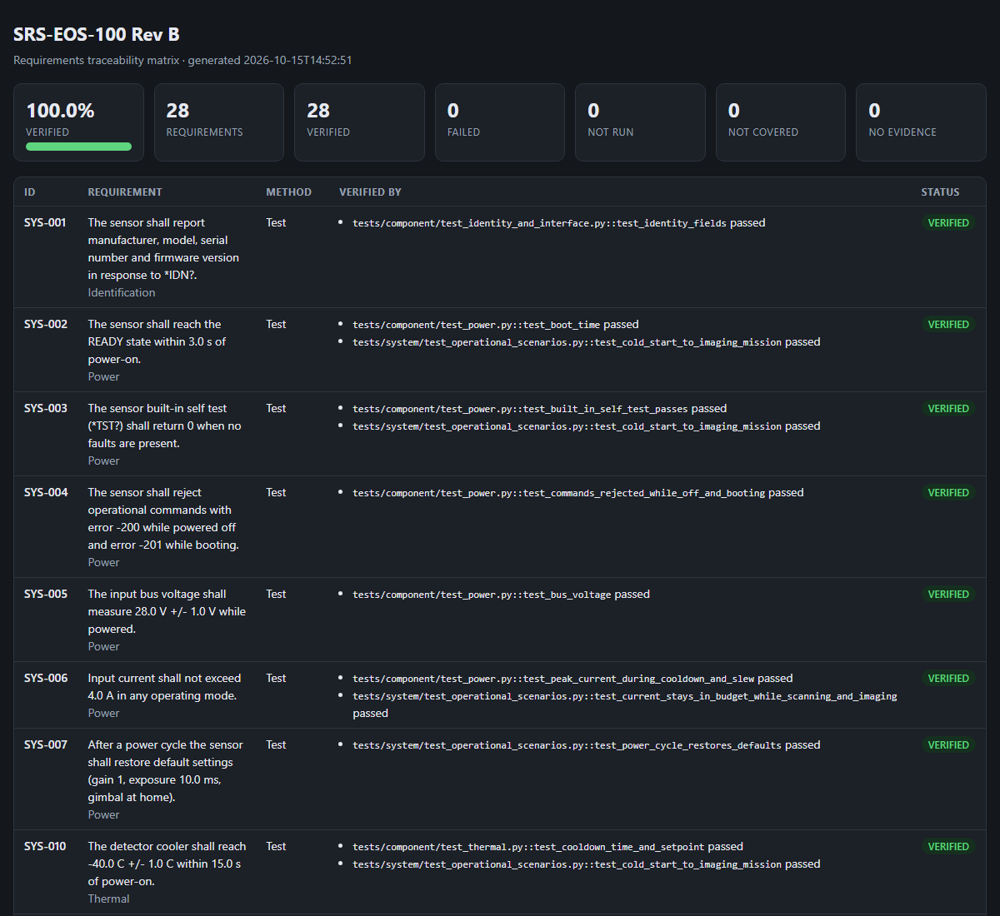

# EO Sensor Test Station

[](https://github.com/KyleEGibson/eo-sensor-test-station/actions/workflows/ci.yml)


An automated integration and test station for a simulated electro-optical sensor (the EOS-100), with built-in **requirements traceability**.

The sensor is a pure-software model of a cooled IR camera with a two-axis gimbal. The test station talks to it over a serial-style protocol, runs component-level and system-level functional tests against requirement limits, injects hardware faults, and produces a test report, a results database and a requirements traceability matrix (RTM) on every run.

**[Latest test report](https://kyleegibson.github.io/eo-sensor-test-station/)** · **[Latest RTM](https://kyleegibson.github.io/eo-sensor-test-station/rtm.html)** (published by CI)

| Passing run | Run with an injected fault |
|---|---|
|  |  |



## What this demonstrates
| Integration/test engineering task | Where |
|---|---|
| Test plans, procedures, test cases | [`docs/test_plan.md`](docs/test_plan.md), `tests/component`, `tests/system` |
| Requirements traceability | [`requirements/requirements.yaml`](requirements/requirements.yaml) + `src/pytest_rtm` (RTM in HTML/Excel/JSON/Markdown) |
| Functional tests at component and system level | `tests/component/*`, `tests/system/*` |
| Scripting and test automation | `src/test_station` (pyserial driver + pytest test executive) |
| Setting up and configuring the system under test | `src/eos_sim`, `--dut-url`, `--time-scale`, `--inject-fault` |
| Root cause analysis and corrective action | [Defects found](#defects-found-during-development) below; `reports/comm_log.tsv` transcript |
| Failure and trend analysis | [`docs/fault_campaign.md`](docs/fault_campaign.md); append-only `results.db` |
| Configuration management | Git commit recorded in every report; CI on every push; database schema migration |
| Technical documentation | [ICD](docs/interface_control_document.md), [test plan](docs/test_plan.md), [design decisions](docs/design_decisions.md) |

## Architecture
```mermaid
flowchart LR
  SRS[requirements.yaml] --> RTM[pytest-rtm plugin]
  T[pytest tests] -->|@pytest.mark.req| RTM
  T --> D[EOSensor driver<br/>pyserial]
  D <-->|ASCII + XOR checksum| S[EOS-100 simulator<br/>fault injection]
  T --> DB[(results.db)]
  T --> R[test_report.html]
  RTM --> M[rtm.html / .xlsx / .json / .md]
```

## Quick start
```bash
python -m venv .venv
.venv\Scripts\activate            # Windows  (source .venv/bin/activate on Linux/macOS)
pip install -e ".[dev]"
pytest --rtm-strict               # 81 tests, about 15 s; outputs go to reports/
```
Run against a separately launched simulator (or real hardware on a COM port):
```bash
python -m eos_sim --port 5025 --fault TEMP_DRIFT
pytest --dut-url socket://127.0.0.1:5025 --time-scale 1
```
Inject a fault for a whole run, or run the full fault campaign:
```bash
pytest tests/component tests/system --inject-fault GIMBAL_STALL
python scripts/fault_campaign.py  # about 2 min; writes docs/fault_campaign.md
```

## Fault campaign
A test suite that cannot fail proves nothing. The campaign reruns the acceptance suites once per injectable fault:

| Fault | Expected | Tests failed | Result |
|---|---|---:|---|
| none (baseline) | all pass | 0 / 43 | PASS |
| TEMP_DRIFT | detected | 1 / 43 | PASS: only the stability test catches it; the sensor's own BIT does not |
| GIMBAL_STALL | detected | 15 / 43 | PASS |
| VOLT_SAG | detected | 3 / 43 | PASS |
| DEAD_PIXELS | detected | 3 / 43 | PASS |
| COMM_DROP | tolerated | 0 / 37 | PASS: 145 retries |
| COMM_CORRUPT | tolerated | 0 / 37 | PASS: 3,330 corrupted responses discarded |

Full details are in [`docs/fault_campaign.md`](docs/fault_campaign.md).

## Layout
```
requirements/      SRS with IADT verification methods (28 requirements)
src/eos_sim/       device simulator (the DUT) + TCP server
src/test_station/  driver, spec limits, results DB, HTML report, pytest plugin
src/pytest_rtm/    reusable traceability plugin (no dependency on the station)
scripts/           fault campaign
tests/unit/        simulator model tests (fake clock)
tests/component/   per-subsystem acceptance tests
tests/system/      end-to-end operational scenarios
tests/station/     verification of the station itself (TS-xxx requirements)
docs/              ICD, test plan, design decisions, fault campaign results
```

## Defects found during development
Real issues found while building and testing the station. Each is described in its commit message.

| # | Symptom | Root cause | Corrective action |
|---|---|---|---|
| 1 | Saturation test failed | Simulated sensor's maximum signal (4064) never reached the 12-bit ADC limit (4095) | Corrected the response constant |
| 2 | Cooler tests failed on every run | Polled `COOL:STAT?` while the sensor was booting, which it rejects with −201 | Wait for READY first; cooldown still timed from power-on |
| 3 | RTM plugin crashed at session end | A rejected requirement ID had already been stored as a trace link | Validate all links before storing any |
| 4 | Drift fault: cooler never reported READY | Simulated drift began the instant the cooler reached its band | Added a 2 s hold before drift begins |
| 5 | Fault campaign hung | Current test looped on `MOVING` with no deadline; a stalled gimbal never stops moving | Added a settle deadline and a per-run campaign timeout |
| 6 | 3 timing tests failed on a healthy sensor under COMM_DROP | Read timeouts from dropped responses were counted as device delay | Marked timing tests; comm-fault runs check functional behavior only; report flags retries per test |
| 7 | Crash with a new `--report-dir` | Comm log was written before the directory existed | Create the directory first; regression test added |
